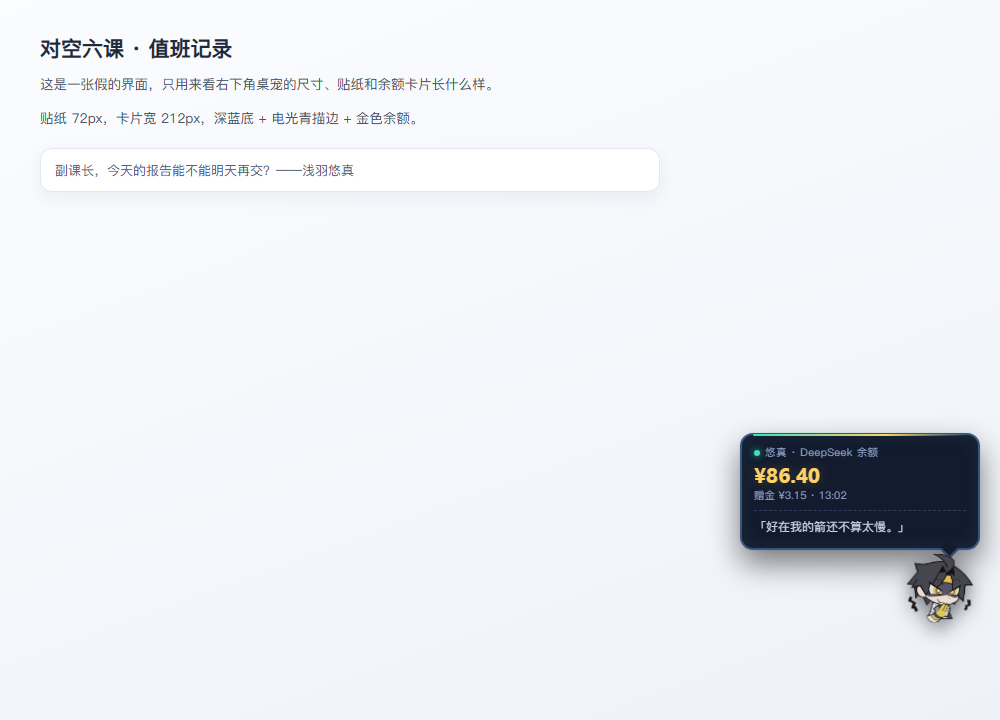

# 浅羽悠真桌宠（dsh-harumasa-widget）

DeepSeek Harness（DSH）右下角的一只 Q 版「浅羽悠真」贴纸。

- **桌宠**：72px 的悠真贴纸，可拖动、记忆位置、轻微悬浮；点一下弹出小卡片，显示 DeepSeek 余额（总余额 / 充值余额 / 赠金）和一句悠真的台词，并闪一下「⚡」。
- **不覆盖主题**：这个插件只加桌宠，不改界面配色，禁用后界面完全不受影响。



## 文件结构

```
client.js           加载桌宠脚本（客户端半）
index.js            注册 /dsh-harumasa/pet.js 与 /dsh-harumasa/balance.json 路由，并向页面注入脚本（宿主半）
pet.js              桌宠本体：shadow root、拖拽、余额卡片（内含贴纸 base64）
cordis.patch.yml    插件在 DSH 中的插入声明
package.json        插件清单（dsh.bundle / dsh.client）
locale/             插件描述的中英文文案
icon.png / icon.svg 插件图标
preview.png         预览图
```

## 安装

插件以本地目录的形式挂进 DSH 桌面端 profile，两种方式任选其一。

**方式一：插件管理器**

在 DSH 桌面端的插件管理里按本地目录添加 `harumasa-widget`，然后启用。

**方式二：手动挂载**

1. 编辑 `%USERPROFILE%\.dsh\profiles\desktop\package.json`，加入依赖：

```json
{
  "dependencies": {
    "@local/harumasa-widget": "link:D:/文档/deepseek-harness/default-workspace/harumasa-widget"
  }
}
```

2. 在同一个文件的 `dsh.profile.bundles` 里加上 `@local/harumasa-widget`：

```json
{
  "dsh": {
    "profile": {
      "bundles": [
        "@deepseek-ai/dsh-base",
        "@deepseek-ai/dsh-web-app",
        "@local/harumasa-widget"
      ]
    }
  }
}
```

3. 在 profile 目录执行 `pnpm install`，然后重启 DSH。

> 只加依赖、不加进 `bundles` 不会生效；改完必须重启一次 DSH。

## 使用

- 拖动贴纸到任意位置，位置保存在浏览器 localStorage，下次打开自动还原。
- 点击贴纸展开/收起余额卡片，卡片会按屏幕边缘自动翻转（左右换边、上下换向），避免出界。
- 每次点击换一张贴纸、随机一句台词；余额 60 秒内不会重复请求。
- 余额来自宿主侧的 `deepseekAccount` 服务，接口只监听 loopback，不会把凭据暴露给页面。

## 台词

卡片里的台词取自游戏内悠真的官方文本（代理人档案、天赋描述、名片等），例如：

- 「很高兴认识你，除非你是来叫我加班的。」
- 「别看我这样，我其实很弱很弱的~」
- 「不管是明枪还是暗箭，能让我早点下班的都是好孩子~」
- 「咳咳，感觉我的病情加剧了…」
- 「副课长，真的不给我张病假条吗？」
- 「好在我的箭还不算太慢。」
- 「我可是要遗千年的。」

要加台词，改 `_build/haru/pet.template.js` 里的 `LINES`，再跑一次 `python _build/haru/build.py` 生成 `pet.js`。

## 更新贴纸

`_build/haru/build.py` 会把 `_build/haru/emoji/` 里的两张官方聊天表情转成 webp（透明底、256px），塞进 `pet.js`，并顺手生成 `icon.png` / `icon.svg`。

```powershell
python _build/haru/build.py        # 重新生成 pet.js 和图标
node _build/haru/smoke.mjs         # 无浏览器冒烟测试：挂载、点击、台词、余额
```

## 卸载

从 profile 的 `dependencies` 和 `bundles` 中移除 `@local/harumasa-widget`，执行 `pnpm install` 后重启 DSH 即可。

## 素材来源

贴纸取自《绝区零》官方聊天表情「浅羽悠真」两张，仅作同人作品使用；《绝区零》相关版权归米哈游所有。
